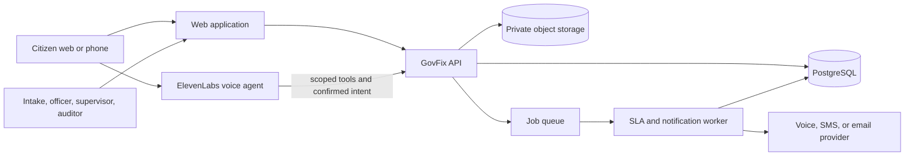

# Proposed architecture

**Status:** The modular backend uses FastAPI, SQLAlchemy, and Alembic, with Supabase PostgreSQL selected as the project database and SQLite available for isolated tests/local demos. Phase 2 adds a React client and private local image storage; Phase 3 adds a polling worker and in-app notifications; Phase 4 adds explicit citizen verification and scheduled supervisor wait alerts. Production storage, external notification providers, voice, and deployment remain proposals. See [backend setup](./backend.md) and the [implementation tracker](./implemented.md).

## System context

The **GovFix API is the sole authority** for case mutations. Browser and voice channels receive the same authorization and transition rules. The worker may execute only policy-defined system actions, such as escalation and notification; it does not invent workflow decisions.

## Proposed components

| Component | Responsibility | Proposed implementation |
|---|---|---|
| Web application | Citizen and staff interfaces, accessible text fallback | React with TypeScript, Vite and Tailwind; Phase 2 implemented |
| API | Auth context, workflow service, policy evaluation, case queries, assignment, evidence metadata, audit writes | FastAPI with Python 3.12, SQLAlchemy, and Alembic; Phase 1 implemented |
| Database | Cases, versioned policies, assignments, SLA state, event history | Supabase PostgreSQL; SQLite for tests/local demos; Phase 1 schema implemented |
| Object storage | Private evidence and optional voice artifacts | Private local files for the demo; authenticated downloads. S3-compatible production storage remains planned |
| Job queue and worker | Deadline checks, escalation, notifications, retry handling | Database outbox and indexed polling worker implemented; production process supervision remains open |
| Voice provider | Speech, conversation, status tools, confirmed action intents, optional outbound calls | ElevenLabs Agents and documented webhook tools |
| Notification adapter | Citizen and staff alerts | Provider-neutral API, with one pilot channel implemented first |

The stack choices above are recommendations. No specific cloud host, authentication vendor, SMS provider, or deployment topology has been selected.

## Command flow

1. The channel sends an authenticated request with an idempotency key and case version.
2. API authenticates the user and obtains roles and case scope from trusted records.
3. Workflow service loads the case and its pinned policy version under a database transaction.
4. It checks current state, transition, actor role, ownership, required data, and optimistic version.
5. It writes the mutation and audit event in the **same transaction**. A refusal writes an audit attempt without changing the case.
6. Transactional outbox rows request asynchronous notifications or voice calls. A worker retries delivery without replaying the case mutation.

The exact database locking pattern is an implementation choice. The invariant is that two concurrent requests cannot both transition from the same prior version.

## Voice trust boundary

The ElevenLabs agent may call read-only case tools after identity verification. For an action, it submits a **proposed intent** bound to a verified person, case, conversation, explicit confirmation, and idempotency key. The API rechecks everything; no model-provided role, deadline, state, category, or owner is trusted. Do not expose a general `updateCase` tool. Use operation-specific endpoints and constrained payloads as described in [api.md](./api.md).

Post-call webhooks store conversation metadata and transcript/summary when consent and retention policy permit. A post-call summary alone must never trigger a status change. Outbound verification requires both identity proof and an unambiguous acceptance or dispute response; uncertain speech should be handed to a human or the text channel.

## Service boundaries

- **Workflow/policy:** transition graph, role rules, evidence predicates, reason codes.
- **Case and assignment:** current owner plus ownership intervals; assignments are governed actions.
- **SLA:** deadline and threshold evaluation, extension, escalation level. SLA status is independent of workflow state.
- **Evidence:** private upload, checksum, metadata, and access control.
- **Audit:** append-only event API and scoped projections for each role.
- **AI recommendations:** separate suggestions with model provenance and human decision; never write official case fields directly.

Start as a **modular backend** with these boundaries rather than independent microservices. This keeps the critical mutation and audit event transactional. Split services only if scale or ownership demands it.

## Reliability and operations

- Use UTC for stored instants and an explicit municipal time zone for deadline display and policy calendars.
- Pin cases to policy versions. A later policy publication cannot silently change an open case's deadline or transition rules.
- Use durable outbox records for notifications; preserve case outcome when a provider is unavailable.
- Use unique idempotency keys for client actions, voice callbacks, and escalation thresholds.
- Monitor transition refusal rate, unassigned age, overdue age, worker lag, notification failures, and audit write failures. An audit write failure must fail the governed mutation.
- Back up database and object storage, and rehearse restore before a production pilot.

See [database.md](./database.md), [security-privacy.md](./security-privacy.md), and [validation.md](./validation.md) for detailed invariants and checks.
