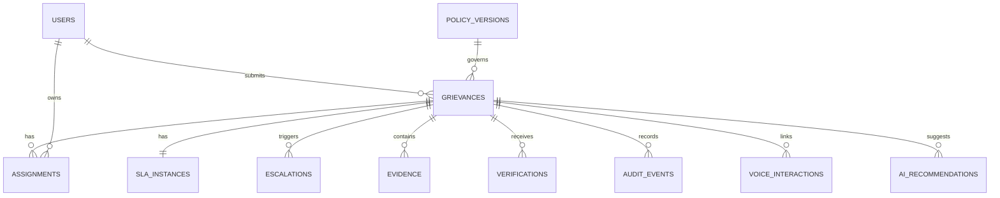

# Proposed database design

**Status:** Phase 1 migrations implement users, role grants, authentication sessions, policy versions, cases, ownership intervals, evidence metadata, audit, idempotency, and outbox records. The table below remains the broader P0 logical design. Initial SLA fields currently live on cases; verification/review decisions live in audit details. Escalation, voice, recommendations, and separate SLA/verification entities remain future work. See [models](../govfix/models.py) and [backend setup](./backend.md).

## Entity relationships

## Core tables

| Table | Important columns | Integrity rule |
|---|---|---|
| `users` | `id`, `contact_ref`, `display_name`, `status`, `created_at` | Personal data access is scoped. Do not use phone number as the public case ID. |
| `user_roles` | `user_id`, `role`, `jurisdiction_scope` | Roles are loaded from trusted storage, not client or model input. |
| `policy_versions` | `id`, `version`, `status`, `effective_at`, `definition_json`, `checksum`, `published_by` | Published versions are immutable; validate graph and threshold schema before publication. |
| `grievances` | `id`, `public_id`, `citizen_id`, `workflow_state`, `category`, `department`, `ward`, `location`, `description`, `owner_id`, `policy_version_id`, `submitted_at`, `closed_at`, `version` | Unique public ID; nonnegative version; one current state and pinned policy. |
| `assignments` | `id`, `grievance_id`, `officer_id`, `department`, `assigned_by`, `reason`, `started_at`, `ended_at` | At most one active ownership interval per case; reassign transaction closes old interval and opens new one. |
| `sla_instances` | `grievance_id`, `policy_version_id`, `original_deadline`, `current_deadline`, `status`, `escalation_level`, `calendar_id`, `updated_at` | One SLA row per case; original deadline never overwritten. |
| `escalations` | `id`, `grievance_id`, `policy_version_id`, `threshold_key`, `level`, `recipient_role`, `occurred_at`, `notification_state` | Unique `(grievance_id, policy_version_id, threshold_key)`. |
| `evidence` | `id`, `grievance_id`, `uploader_id`, `kind`, `object_key`, `sha256`, `captured_at`, `uploaded_at`, `gps`, `mime_type`, `size_bytes` | Private object key; upload is linked to case and uploader; hash is computed server-side or verified. |
| `verifications` | `id`, `grievance_id`, `citizen_id`, `outcome`, `statement`, `channel`, `verified_at`, `voice_interaction_id` | Outcome is explicit accept or dispute, not a sentiment inference. |
| `audit_events` | `id`, `grievance_id`, `event_type`, `result`, `reason_code`, `actor_type`, `actor_id`, `actor_role`, `channel`, `occurred_at`, `case_version`, `policy_version_id`, `request_id`, `before_json`, `after_json`, `previous_hash`, `event_hash` | Append-only application writes; indexed by case and time; public projections redact protected data. |
| `voice_interactions` | `id`, `provider_conversation_id`, `grievance_id`, `participant_id`, `language`, `consent_ref`, `transcript_object_key`, `summary`, `started_at`, `ended_at` | Provider ID unique; optional transcript exists only under consent/retention policy. |
| `ai_recommendations` | `id`, `grievance_id`, `type`, `proposed_value_json`, `confidence`, `model_id`, `created_at`, `reviewed_by`, `decision` | Separate from official case fields; review decision records accept or override. |
| `idempotency_records` | `actor_id`, `operation`, `key`, `request_hash`, `response_ref`, `created_at` | Same key and payload return prior result; same key with different payload is rejected. |
| `outbox_messages` | `id`, `event_id`, `kind`, `payload_json`, `status`, `attempts`, `next_attempt_at` | Created in the same transaction as governed event; retries do not repeat case mutation. |

Additional `comments`, `notification_deliveries`, and policy authoring tables may be added when corresponding features are built. Keep immutable audit events separate from editable display projections.

## Transaction invariants

1. **Accepted transition:** Lock or compare the case version; validate policy, role, ownership, edge, and requirements; update case; append audit event; create outbox message; commit together.
2. **Refused transition:** Preserve case and assignment rows; append a refusal audit event with reason, attempted operation, and observed case version. Avoid leaking protected case details in the API response.
3. **Assignment:** End the old active interval and create the new interval atomically with the current owner update and audit event.
4. **Escalation:** Insert a threshold-unique escalation, update level/status, append audit event, and enqueue notification in one transaction. A duplicate worker execution becomes a no-op or returns the existing event.
5. **Deadline extension:** Preserve `original_deadline`, record old/current deadlines and supervisor reason in audit, and enqueue citizen notification.
6. **Evidence:** Store objects privately. Do not mark required evidence present until upload completion, checksum verification, and metadata commit succeed.

## Indexes and retention

- Index cases by `(workflow_state, ward, owner_id)`, `(current_deadline)` through SLA rows, and `(citizen_id, submitted_at)` for queues and lookup.
- Index audit by `(grievance_id, occurred_at, id)` and `request_id`; index unprocessed outbox rows by status and next attempt.
- Use a partial unique index for the active assignment interval and unique constraints for escalation thresholds and idempotency keys.
- Define deletion, archival, and legal hold rules with the institution before production. Expiring voice content must not destroy the minimal lawful audit record, but retention must not be indefinite by default.
- A per-case hash chain is optional tamper evidence. It is not proof of immutability by itself; restrict DB writers and consider independent log export for production.

## Schema migration rule

Migrations must preserve existing case state, pinned policy version, original deadline, ownership intervals, and audit order. Backfills that affect governed fields need an explicit service actor and migration event rather than silent updates.
