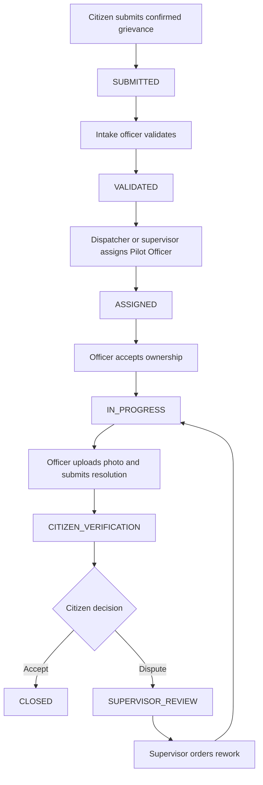

# Demo accounts and grievance handoff

Seven human-role demo accounts are provisioned in Supabase PostgreSQL. Passwords
are saved locally in `var/private/pilot-login-credentials.json`, a private file
excluded from Git. The accounts use the application's local login provider and
Argon2 password hashes.

| Account | Role | Dashboard | Scope |
|---|---|---|---|
| `pilot-citizen` | CITIZEN | Citizen | Own grievances |
| `pilot-intake` | INTAKE_OFFICER | Supervisor / Operations | WARD-A |
| `pilot-dispatcher` | DISPATCHER | Supervisor / Operations | WARD-A, PUBLIC_WORKS |
| `pilot-officer` | OFFICER | Officer | WARD-A, PUBLIC_WORKS; mutations require ownership |
| `pilot-supervisor` | SUPERVISOR | Supervisor / Operations | WARD-A |
| `pilot-ward-head` | WARD_HEAD | Supervisor / Operations | WARD-A; oversight and escalation visibility |
| `pilot-auditor` | AUDITOR | Auditor | WARD-A; read-only auditing |

`WORKFLOW_ENGINE` is an internal actor with no login account. Administration and
account provisioning use the trusted CLI or database administrator; the project
does not define an ADMIN login role.

## Demo flow

Use a **POTHOLE** grievance in **WARD-A** so it routes to **PUBLIC_WORKS** and all
the provisioned staff are in scope. Each account reads the same case record;
handoffs change state or ownership rather than copying records between accounts.

| Step | Account | Data written or read |
|---|---|---|
| 1. Submit | Citizen | Description, location, category, ward and explicit confirmation; creates case with pinned policy and deadline |
| 2. Validate | Intake officer | Reviews jurisdiction/category/routing; records validation, or rejection with coded reason and explanation |
| 3. Assign | Dispatcher or supervisor | Selects eligible officer, records assignment reason and ownership interval |
| 4. Accept | Officer | Confirms ownership; case enters IN_PROGRESS |
| 5. Resolve | Officer | Uploads private evidence, records resolution note and evidence references; workflow opens citizen verification |
| 6. Verify | Citizen | Reads resolution/evidence; explicitly accepts to close or disputes with a statement |
| 7. Review dispute | Supervisor | Reads dispute and history; records rework reason, retaining the officer or assigning another eligible owner |
| 8. Oversee | Ward head | Reads escalations, case history and ownership within the granted ward |
| 9. Audit | Auditor | Inspects accepted/refused events, ownership, SLA history, delivery diagnostics and policy |

Every governed operation records its audit event in the same transaction as the
state change. Permission and visibility checks apply at each read/action. The
citizen sees their own cases; staff see only granted wards/departments, and field
mutations require the current owner.

## Automatic processing

Keep `govfix worker --poll-seconds 30` running for the free Render demonstration.
The worker observes deadlines and writes notifications to authenticated inboxes:

- Warning threshold → assigned officer.
- SLA breach → supervisor.
- Ward-head threshold → ward head.
- Submitted resolution → citizen verification notification.
- Citizen dispute or unanswered verification window → supervisor review notice.

The fictional pothole policy has a 72-hour elapsed SLA, with warning at 80%,
supervisor escalation at 100%, and ward-head escalation at 150%. These thresholds
are not immediate demo events. Citizen silence does not automatically close a case.

## Verification

The accounts were provisioned through the Supabase plugin and verified through the
deployed application's `/v1/auth/login` and `/v1/me`. Verification sessions were
logged out afterward. Existing citizen/auditor passwords were retained; five
staff accounts were added. This account check does not create demo grievances.

Deploy the four-dashboard code update in Render to show its dedicated layouts.
Role permissions are already stored in the shared Supabase database and apply to
the existing deployed API immediately.
