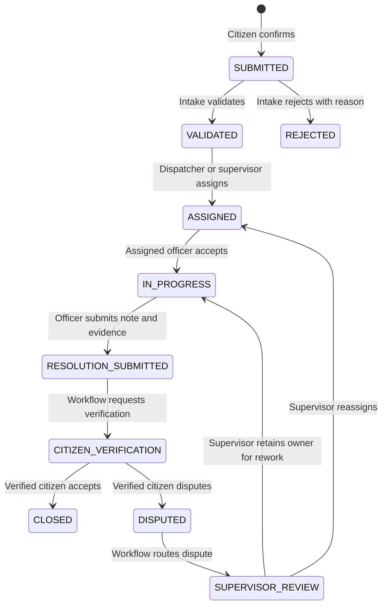

# Municipal grievance workflow

**Status:** Phases 1–4 implement the graph, private evidence, operating screens, SLA monitoring, and explicit citizen verification with supervised rework. Voice channels remain a later phase. Production category policies require municipal approval. See the [implementation tracker](./implemented.md).

## Case dimensions

| Dimension | Values / meaning |
|---|---|
| `workflow_state` | The case's legal operational step. See transition table below. |
| `sla_status` | `ON_TRACK`, `WARNING`, or `OVERDUE`, calculated from the effective deadline. |
| `escalation_level` | Nonnegative integer set only by policy-triggered worker actions. |
| `current_owner` | One accountable officer after assignment; prior owners remain in assignment intervals. |

`OVERDUE` and `ESCALATED` are not workflow states. An `IN_PROGRESS` case can be overdue and escalated at the same time.

## States and transitions

`REJECTED` and `CLOSED` are terminal in P0. A future appeal/reopen policy must specify who may act, a time limit, and a new transition graph before those actions are enabled.

| Transition | Actor | Gate |
|---|---|---|
| New → `SUBMITTED` | Authenticated citizen | Required description and location; explicit final confirmation |
| `SUBMITTED` → `VALIDATED` | Intake officer | Official category, ward, jurisdiction, and department confirmed |
| `SUBMITTED` → `REJECTED` | Intake officer | Reason code plus explanation; no silent disposal |
| `VALIDATED` → `ASSIGNED` | Dispatcher or supervisor | Eligible owner and department; assignment interval starts |
| `ASSIGNED` → `IN_PROGRESS` | Assigned officer | Assignment acceptance captured |
| `IN_PROGRESS` → `RESOLUTION_SUBMITTED` | Assigned officer | Resolution note and configured required evidence |
| `RESOLUTION_SUBMITTED` → `CITIZEN_VERIFICATION` | Workflow engine | Verification request created once |
| `CITIZEN_VERIFICATION` → `CLOSED` | Verified citizen | Explicit acceptance; no agent inference |
| `CITIZEN_VERIFICATION` → `DISPUTED` | Verified citizen | Explicit dissatisfaction and statement |
| `DISPUTED` → `SUPERVISOR_REVIEW` | Workflow engine | Review task created once |
| `SUPERVISOR_REVIEW` → `ASSIGNED` or `IN_PROGRESS` | Supervisor | Reason and rework owner recorded |

## Other governed commands

Assignment change, category correction, deadline extension, evidence upload, and citizen verification are governed commands even when `workflow_state` does not change. Each has its own role and data checks and an audit event. Category change after submission must not silently recalculate the SLA: the policy must define whether a supervisor approves a new deadline and the old deadline remains visible.

## Refusal behavior

The API rejects skipped states, forbidden edges, wrong roles, wrong case owners, missing evidence, stale case versions, and unverified voice actions. It returns a stable reason code and a human-readable explanation. It also stores the attempted actor, requested operation, case/state at the time, channel, timestamp, and refusal reason. A refusal changes no case or assignment data.

Suggested codes: `INVALID_TRANSITION`, `ROLE_NOT_ALLOWED`, `NOT_ASSIGNED_OWNER`, `REQUIRED_FIELD_MISSING`, `EVIDENCE_REQUIRED`, `CASE_ACCESS_DENIED`, `STALE_CASE_VERSION`, `IDENTITY_OR_CONFIRMATION_REQUIRED`, and `POLICY_NOT_FOUND`. Public messages must not leak private case details to an unauthorized requester.

## SLA behavior

The clock starts at submission. The case stores a policy version, original deadline, current deadline, and calendar/time-zone basis. P0 runs the clock until `CLOSED` or `REJECTED`; it never pauses silently. `WARNING` and `OVERDUE` are derived from the current time and deadline. Example pilot thresholds are 80% warning, 100% supervisor escalation, and 150% ward-head escalation. These values are **illustrative**, not official municipal policy.

Each threshold has a unique `(case, policy version, threshold)` event. Worker retries may resend a failed notification, but they cannot create a second escalation. A supervisor extension preserves old and new deadlines, reason, actor, time, prior breaches, and citizen notification. Phase 3 delivers notifications to in-app inboxes with bounded retry and visible failure status; see [SLA operations](./sla-operations.md). The verification waiting period remains visible; after a configured window it creates a supervisor task, not automatic closure.

## Policy versioning

Publish immutable policy versions with category rules, transition graph, role gates, evidence requirements, SLA calendar, thresholds, and escalation recipients. A case references the version effective at submission. Changes to an active case require an explicit, separately audited migration or exception. A configuration editor is a later feature; a validated configuration file or controlled admin form is sufficient for P0.

## Required demonstrations

The [validation plan](./validation.md) must show a valid end-to-end case, a refused `ASSIGNED → CLOSED` attempt, wrong-role and wrong-owner refusals, missing-evidence refusal, overdue escalation with a worker retry, accepted citizen closure, and disputed citizen rework.
